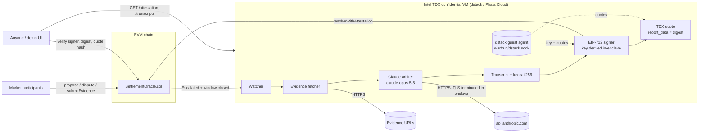

# AI Settlement Oracle

**Prediction-market resolution where an AI running inside a TEE settles the disputes that humans can't.**

This repo is a working MVP of the design in ORA's [*AI Settlement Oracle: Resolving to Truth*](https://paragraph.com/@orablog/ai-settlement-oracle). It keeps the optimistic-oracle flow that already works for ordinary markets. When a market is disputed twice, the final decision moves from a token-holder vote to a verifiable AI arbiter. Here that arbiter is Claude (`claude-opus-5-5`), called from an Intel TDX confidential VM (via [dstack](https://github.com/Dstack-TEE/dstack) / Phala Cloud). Every verdict is signed by a key that never leaves the enclave, and the TDX quote ties that key to the exact code that is running.

| Component | Status |
|---|---|
| Solidity contract: optimistic proposals, single/double challenge, evidence staking, AI resolution, delay/manual fallback, reward/slash payouts | ✅ 15 Foundry tests |
| Oracle service: evidence fetching, Claude arbiter (structured output), EIP-712 signing, TDX quotes, on-chain submission, watcher | ✅ Unit tests + end-to-end run on anvil |
| Demo UI: full market lifecycle, evidence submission, AI rounds, in-browser verification of every resolution | ✅ |
| TEE deployment (Phala Cloud compose + Dockerfile + CI image build) | ✅ Ready to deploy (see [Deploying into a TEE](#deploying-into-a-tee)) |
| On-chain verification of the TDX quote itself | 🔜 Roadmap (quote hash is anchored on-chain; the quote is verified off-chain today) |

---

## The problem

Most prediction markets (Polymarket via UMA, for example) resolve through an **optimistic oracle**. Someone proposes an outcome with a bond. If nobody disputes it within a liveness window (about 2 hours on UMA), it's final. Disputed markets escalate to a vote by UMA token holders (the DVM, UMA's Data Verification Mechanism).

The ORA article identifies two weaknesses in that final step:

1. **Economic attack surface.** The cost of corrupting the outcome is bounded by the cost of acquiring a voting majority of the token. On high-volume markets, the money that can be won by flipping the result can exceed what it costs to buy those votes.
2. **Herd decision-making.** Voters are rewarded for agreeing with the majority, not for being right. That invites conformity and lets subjective reinterpretations of the resolution criteria win. The article cites contested real-world markets such as the 2024 Venezuelan election.

Long-tail markets make this worse. Questions like *"Will NASA find definitive evidence of extraterrestrial life in 2025?"* need someone to read the evidence against carefully worded criteria. Is a "potential biosignature" definitive? Are amino acids "life"? A price feed can't answer that. A token vote may not answer it honestly.

## The design → this MVP

The ORA design keeps the optimistic oracle for "business as usual" and changes only the **double-challenge** path. Here's how each component maps:

| ORA concept | Implementation here |
|---|---|
| OO submission system (propose + bond, liveness) | `propose()` / `settle()` in [`SettlementOracle.sol`](contracts/src/SettlementOracle.sol) |
| Single challenge: dispute resets the request | First `dispute()` returns the market to `Open`; bonds stay escrowed on their sides |
| Double challenge: escalate | Second `dispute()` moves the market to `Escalated` and opens an evidence window |
| Token holders collect verifiable evidence and submit evidence plus a verdict, with stake | `submitEvidence(verdict, uri, contentHash)` with an ETH stake; a rolling `submissionsHash` commits to the exact set |
| Query the AI oracle with all submissions | Oracle watcher detects closed windows, fetches every evidence URL **inside the TEE**, and sends criteria, verdicts and evidence to Claude |
| AI Settlement Oracle issues the final verdict | Claude returns `{outcome, confidence, reasoning, evidence_assessments, …}` via structured outputs; the enclave key signs it (EIP-712) and the contract verifies the signer |
| Verdicts matching the AI are rewarded, opposing ones slashed | `claim()`: winners split the losing pool pro rata; `INVALID` refunds everyone |
| "Verifiable AI" (opML/zkML in the article) | **TEE attestation**: TDX quote ties the signer key to the measured compose and image; per-resolution quote ties each digest to the enclave; full transcript hash is signed |
| Accountability concerns ("an AI can't be held accountable") | Confidence threshold: low-confidence verdicts **delay** instead of settling; after 3 delays the market pauses for an accountable human (`manualResolve`) |

Two design choices go beyond the article. Both come from the project's working [NOTES](NOTES.md):

- **Calibrated confidence with delay.** Each market sets a threshold (default 70%). Below it, the contract records a `ResolutionDelayed` event, reopens the evidence window, and the AI tries again with more evidence. It never forces a coin flip.
- **Evidence is untrusted input.** The model is told to weigh evidence by quality, not by headcount or stake (the herd problem), and to ignore instructions embedded in submitted documents (prompt injection).

## Architecture



### Lifecycle

```
             propose (bond)            no dispute within liveness
  Open ───────────────────────▶ Proposed ─────────────────────────▶ Resolved ──▶ claim
   ▲                              │
   │ 1st dispute (bond): reset    │ 2nd dispute (bond)
   └──────────────────────────────┤
                                  ▼
                              Escalated ── submitEvidence (stake + verdict + URL) ──┐
                                  │                                                │
                         window closes, oracle runs in TEE  ◀──────────────────────┘
                                  │
             confidence ≥ threshold│                    confidence < threshold
                    ┌─────────────┴──────────────┐
                    ▼                            ▼
                Resolved                   Delayed: window reopens (round += 1)
          (YES / NO / INVALID)                   │ after maxDelays
                                                 ▼
                                          PausedForManual ── owner.manualResolve ──▶ Resolved
```

## Trust model

The TEE changes **who you have to trust**. It doesn't make the AI infallible.

| Layer | Without a TEE (operator-run oracle) | With this MVP |
|---|---|---|
| Signing key | Operator holds it and can sign anything | Derived inside the TDX VM by the dstack KMS; host and operator cannot read it |
| Oracle code | Whatever the operator happens to run | Measured: compose hash and image digest are in RTMR3 and reported in the quote |
| Evidence fetch | Operator could swap or cache content | Fetched inside the enclave; time, raw-bytes hash and text hash are in the signed transcript |
| Prompt and model response | Operator could edit the reasoning | Exact request and response are hashed into `transcriptHash`, which is signed with the verdict |
| API key | Operator-visible | Passed as a Phala **encrypted secret**, decrypted only inside the CVM |
| Submissions the AI saw | Unverifiable | `submissionsHash` must equal the contract's rolling hash or the transaction reverts |

What you still trust:

- **Intel TDX hardware and the dstack/Phala KMS**, the hardware root of trust.
- **Anthropic's API.** Inference runs on Anthropic's infrastructure, not inside this enclave. The attestation proves *this code sent this prompt to `api.anthropic.com` over TLS terminated inside the enclave and received this response*. It does not prove which weights produced the response. The ORA article's opML/zkML approach (or an open-weight model in a GPU TEE) closes that gap, at the cost of model quality. See the roadmap.
- **Evidence sources.** The oracle proves what it read, not that the source told the truth.
- **The contract owner**, who registers enclave signers and handles `PausedForManual` markets. In production this should be a multisig or timelock that only registers signers whose quote verifies against a published compose hash.
- **Semantic correctness.** The model can still be wrong. The confidence threshold, the delay mechanism and full transcripts are the mitigations.

### How a third party verifies a resolution

The demo UI's **🔍 Verify this resolution** button runs steps 1–5 in your browser:

1. **Digest:** recompute the EIP-712 digest from the public fields (`resolutionDigest()` on the contract) and compare it to the oracle's.
2. **Signature:** `ecrecover(digest, signature)` must equal the oracle's signer.
3. **Registration:** `enclaveSigners(signer)` must be active, and its `quoteHash` must equal `keccak256(bootQuote)` from `GET /attestation`.
4. **Per-resolution quote:** its `report_data` must start with the digest.
5. **Transcript:** `keccak256(GET /transcripts/:hash)` must equal the signed `transcriptHash`. Read it to see exactly what evidence and prompt the model saw and what it answered.
6. **Hardware:** verify the boot quote on [proof.t16z.com](https://proof.t16z.com) (or with `dcap-qvl`). Check that its `report_data` equals `keccak256("ai-settlement-oracle:signer:v1" ‖ signer)` and that the compose hash matches [`deploy/phala/docker-compose.yml`](deploy/phala/docker-compose.yml).

---

## Quickstart (local)

Requirements: Node 20+, [Foundry](https://book.getfoundry.sh/), and an Anthropic API key. You can use `LLM_MODE=mock` offline, but then decisions don't come from a model.

```bash
git clone --recurse-submodules https://github.com/alecwaj/AI-Settlement-Oracle && cd AI-Settlement-Oracle
npm install
npm run build:contracts          # forge build + export ABI to oracle/ and demo/

anvil                            # terminal 1: local chain
npm run demo:deploy              # deploys with short demo timings; writes deployments/local.json

cp oracle/.env.example oracle/.env   # set ANTHROPIC_API_KEY
npm run dev:oracle               # terminal 2: oracle (TEE_MODE=dev locally; see below)

npm run demo:seed                # registers the oracle's signer; seeds an escalated NASA market + an open market
npm run dev:demo                 # terminal 3: UI at http://localhost:5173
```

Then:

1. Open market **#1 (NASA 2025)**. It has already been proposed, disputed twice, and has three staked evidence submissions: NASA's Sep 2025 "potential biosignature" release and the Jan 2025 Bennu sample release.
2. Click **⏩ +5 min** to close the evidence window. The watcher picks the market up within seconds, or you can click **Request AI resolution**.
3. Read Claude's verdict, confidence, per-evidence assessment and reasoning, then click **Verify this resolution**.
4. Walk market **#2** through the whole flow yourself: switch accounts in the *Acting as* menu to propose, dispute, propose again, dispute again (escalates), and submit evidence.

**Running the TEE code path locally:** start Phala's simulator (`npx phala simulator start`), then run the oracle with `TEE_MODE=dstack DSTACK_SIMULATOR_ENDPOINT=<socket printed by the simulator>`. The UI labels this *dstack simulator (not a real TEE)*, because the simulator issues quotes that aren't hardware-backed.

## Deploying into a TEE

The production path is a Phala Cloud CVM (Intel TDX). Full runbook: [BUILD_GUIDE.md](BUILD_GUIDE.md#3-deploy-the-oracle-into-a-tee-phala-cloud).

```bash
# 1. Deploy the contract to your chain (e.g. Base Sepolia)
cd contracts && forge script script/Deploy.s.sol --rpc-url $RPC_URL --private-key $DEPLOYER_KEY --broadcast

# 2. Build & push the oracle image (CI does this on main), then pin its digest in deploy/phala/docker-compose.yml
docker build -f oracle/Dockerfile -t ghcr.io/<you>/ai-settlement-oracle:1.0.0 . && docker push ghcr.io/<you>/ai-settlement-oracle:1.0.0

# 3. Deploy the CVM (secrets are encrypted client-side to the CVM)
cp deploy/phala/.env.example deploy/phala/.env   # ANTHROPIC_API_KEY, RPC_URL, CONTRACT_ADDRESS
phala login
phala deploy -n ai-settlement-oracle -c deploy/phala/docker-compose.yml -e deploy/phala/.env --wait

# 4. Fund the enclave signer (it pays gas), verify its quote, then register it
curl https://<cvm-endpoint>/attestation      # signer, bootQuote, composeHash, tcb
cast send $CONTRACT "registerEnclaveSigner(address,bytes32,bytes32)" <signer> <composeHash> <bootQuote.quoteHash> --private-key $OWNER_KEY --rpc-url $RPC_URL
```

The oracle refuses to start in `dstack` mode if the guest-agent socket is missing. It also refuses `LLM_MODE=mock` inside a real TEE, so an attested enclave can't sign mock decisions.

## Configuration (oracle)

| Variable | Default | Purpose |
|---|---|---|
| `TEE_MODE` | `dstack` | `dstack` (TDX CVM or simulator) or `dev` (env key, no attestation) |
| `ORACLE_DEV_PRIVATE_KEY` | n/a | Signing key in `dev` mode only |
| `LLM_MODE` | `anthropic` | `anthropic` or `mock` (mock refused inside a real TEE) |
| `ANTHROPIC_API_KEY` | n/a | Claude API key (an encrypted secret on Phala) |
| `ANTHROPIC_MODEL` / `ANTHROPIC_EFFORT` | `claude-opus-5-5` / `high` | Arbiter model and reasoning effort |
| `RPC_URL` | `http://127.0.0.1:8545` | Chain RPC |
| `CONTRACT_ADDRESS` | from `deployments/local.json` | SettlementOracle address |
| `AUTO_SUBMIT` | `true` | Submit signed resolutions on-chain from the enclave key |
| `WATCH_INTERVAL_MS` | `15000` | Watcher poll interval |
| `ALLOW_PRIVATE_EVIDENCE_HOSTS` | `false` | Allow evidence on localhost/private IPs (SSRF guard off) |
| `DATA_DIR` | n/a | Persist resolution records and transcripts |

Claude is called with adaptive thinking, structured outputs (a Zod schema), and server-side refusal fallbacks. Refusals and truncated outputs are rejected, never signed.

## Oracle API

| Endpoint | Description |
|---|---|
| `GET /health` | Signer, TEE mode, model, contract |
| `GET /attestation` | Signer, boot TDX quote, report data, compose hash, TCB measurements, verification steps |
| `POST /markets/:id/resolve` | Run an AI round now (the market must be escalated with its evidence window closed) |
| `GET /markets/:id/resolutions` | All AI rounds: decision, evidence fetch results, digest, signature, quote, tx |
| `GET /transcripts/:hash` | Exact transcript bytes whose keccak256 was signed |
| `POST /evidence/hash` | Fetch a URL the way the oracle will and return its content hash (helper for submitters) |

## Contract

[`SettlementOracle.sol`](contracts/src/SettlementOracle.sol). Constructor parameters: `proposalBond`, `minEvidenceStake`, `liveness`, `evidenceWindow`, `delayPeriod`, `maxDelays`.

| Function | Who | Notes |
|---|---|---|
| `createMarket(question, criteria, resolutionTime, thresholdBps)` | anyone | Threshold in basis points |
| `propose(id, YES/NO)` | anyone, pays bond | After `resolutionTime` |
| `dispute(id)` | anyone, pays bond | First dispute resets; second escalates |
| `settle(id)` | anyone | After liveness with no dispute |
| `submitEvidence(id, verdict, uri, contentHash)` | anyone, ≥ min stake | One per address per market; updates `submissionsHash` |
| `resolveWithAttestation(id, outcome, confidenceBps, submissionsHash, reasoning, transcriptHash, sig)` | anyone (relayer) | Signer must be a registered enclave key; low confidence delays |
| `claim(id)` | participants | Pro-rata share of the losing pool, or a refund on `INVALID` |
| `registerEnclaveSigner(signer, composeHash, quoteHash)` / `revokeEnclaveSigner` / `manualResolve` | owner | |

## Tests

```bash
npm test     # forge test (15) + oracle vitest (10)
```

The contract tests cover the undisputed path, the single and double challenge flows, the rolling evidence hash, reward/slash math, INVALID refunds, rejection of unregistered, revoked, tampered or stale signatures, the delay → manual-pause path, and replay protection across rounds.

## Roadmap

- **On-chain quote verification:** verify the TDX quote in the contract (e.g. Automata's DCAP verifier) so `registerEnclaveSigner` becomes permissionless for quotes matching an allow-listed compose hash.
- **Full-inference attestation:** run an open-weight model in a GPU TEE (H100/B200 confidential computing), or follow ORA's opML route, so the weights themselves are attested. Keep Claude as an option when judgment quality matters more.
- **zkTLS evidence:** let submitters attach zkTLS proofs of what a source served, as the ORA article suggests.
- **Multi-enclave quorum:** require k-of-n independent enclaves, or models, to agree before settling.
- **Token-denominated bonds and stakes**, an ERC-20 reward token, and the article's alternative "AI first, PoS override" mode.
- **Testnet deployment** with a public CVM and Trust Center listing.

## Repository layout

```
contracts/            Foundry: SettlementOracle.sol, tests, Deploy script
oracle/               TypeScript oracle service (runs in the TEE)
  src/tee.ts          dstack key derivation + TDX quotes (dev-mode fallback)
  src/resolver.ts     Claude arbiter: prompt, structured output schema
  src/evidence.ts     In-enclave evidence fetching + hashing, SSRF guard
  src/oracle.ts       Round orchestration, transcript, EIP-712, submission, watcher
  src/server.ts       HTTP API
  Dockerfile
demo/                 React + viem UI
deploy/phala/         docker-compose for Phala Cloud (dstack)
scripts/              Local demo: deploy, seed, time-warp, ABI export
NOTES.md              Original design notes and research (TEE options, trust analysis)
```

`PROMPT.md`, `claude-prompt.md` and `CLAUDE_CODE_GUIDE.md` are the original build prompts, kept for history.

## License

MIT
