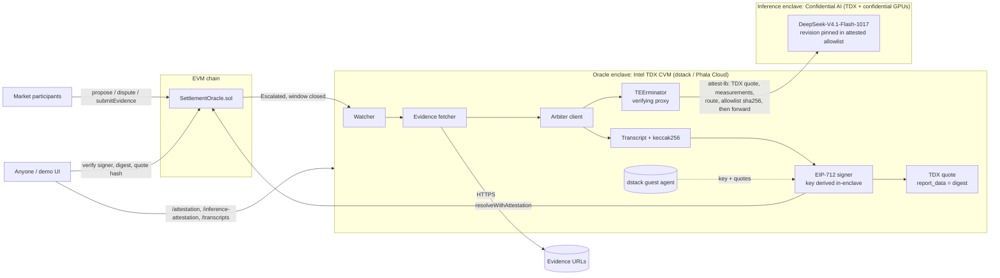

# AI Settlement Oracle

**Prediction markets that settle their hardest disputes with an AI judge whose every verdict can be checked. The code and the model weights both run inside hardware enclaves (TEEs), so nobody, including the operator, can fake a result.**

This is a working MVP of ORA's [*AI Settlement Oracle: Resolving to Truth*](https://paragraph.com/@orablog/ai-settlement-oracle) design. Ordinary markets resolve the usual optimistic way. When a market is **disputed twice**, staked participants submit evidence, and an open-weight model (DeepSeek V4.1 Flash) running in a confidential-GPU enclave decides. Its signed verdict pays out the side that was right.

## 🔗 Live demo

> **Live demo:** _going live as soon as Confidential AI API access is confirmed. The link will be posted here._
> The demo needs no install, no wallet and no API key.

**60-second tour**

1. **Look at the two badges under the title.** The oracle runs in an Intel TDX enclave, and the model runs on Confidential AI's confidential-GPU infrastructure. An amber inference badge means the oracle isn't yet verifying that enclave itself (see [Verification levels](#verification-levels)).
2. **Open market #1 (NASA 2025).** It's been proposed, disputed twice and escalated, with NASA press releases staked as evidence on both sides. Read the AI's verdict, its confidence, and how it rated each piece of evidence.
3. **Click "🔍 Verify this resolution".** Your browser re-checks everything itself:
   - the signed digest;
   - the enclave signer and its on-chain registration;
   - the inference-enclave attestation and the pinned model weights;
   - the hash of the full transcript of what the model saw and said.
4. *Optional:* connect a wallet with Base Sepolia test ETH and walk market #3 through propose → dispute → dispute → evidence.

---

## Understand it in 5 minutes

**The problem.** Prediction markets settle easy questions with a price feed. Fuzzy questions end up decided by token-holder votes. For example: *"Did NASA find definitive evidence of extraterrestrial life in 2025?"* Is a "potential biosignature" definitive? Votes can be bought, and voters are paid for agreeing with the majority rather than for being right.

**The fix.** Keep the optimistic flow for normal markets. Send only twice-disputed markets to an AI arbiter that:

- reads the market's exact criteria and every staked piece of evidence;
- returns a verdict, a calibrated confidence and an auditable rationale;
- **delays instead of guessing** when its confidence is low, by reopening the evidence window.

**Why you can trust the verdict (TEEs).**

| Claim | How it's enforced |
|---|---|
| The oracle can't be tampered with | It runs in an Intel TDX enclave. Its signing key is generated inside and never leaves, and a hardware quote binds that key to the exact code. |
| The model is the one advertised | Inference runs in Confidential AI's enclaves. Their attested policy pins the model repository, revision and weight hash, and the oracle refuses to sign unless that attestation verifies. |
| Nothing was edited after the fact | The exact evidence, prompt and model response are hashed into the signed verdict, and the contract checks the signature. |

**Where to look in the code**

| If you want to see… | Open |
|---|---|
| The market lifecycle, payouts and signature checks | [`contracts/src/SettlementOracle.sol`](contracts/src/SettlementOracle.sol) |
| One AI round end to end | [`oracle/src/oracle.ts`](oracle/src/oracle.ts) (`doResolve`) |
| The prompt and output schema | [`oracle/src/resolver.ts`](oracle/src/resolver.ts) |
| Enclave key and quotes | [`oracle/src/tee.ts`](oracle/src/tee.ts) |
| Inference-enclave attestation | [`oracle/src/inference-attestation.ts`](oracle/src/inference-attestation.ts) |
| In-browser verification | [`demo/src/ResolutionPanel.tsx`](demo/src/ResolutionPanel.tsx) |

## Test it yourself

| Option | Setup | What you get |
|---|---|---|
| **A. Live demo** | None. Open the link above. | The real thing: both enclaves, real model verdicts, verification in your browser |
| **B. Local, no keys** | Node 20+ and Foundry, about 5 minutes | The full flow on a local chain, with a clearly labeled **mock** model standing in for the AI |
| **C. Local, real verifiable inference** | B plus a Confidential AI API key (plus TEErminator for attestation) | Real DeepSeek V4.1 Flash verdicts from your machine |

Instructions for B and C are under [Run it locally](#run-it-locally).

## Status

| Component | Status |
|---|---|
| Contract: optimistic proposals, single/double challenge, evidence staking, AI resolution, delay with manual fallback, reward/slash payouts | ✅ 15 Foundry tests |
| Oracle: evidence fetching, AI arbiter, EIP-712 signing, TDX quotes, inference-enclave attestation, rate limits and spend cap, watcher | ✅ 18 unit tests, plus end-to-end runs |
| Verifiable inference: [Confidential AI](https://confidential.ai/docs) serving **`deepseek-ai/DeepSeek-V4.1-Flash-1017`**, gated by TEErminator | ✅ Integrated. Launches in *unverified-inference* mode with just an API key, and switches to *verified* (fail-closed) once Confidential AI's reviewed pins are set. |
| Demo UI: reviewer tour, read-only mode, deep links, verdicts read from the chain if the oracle is down, in-browser verification | ✅ |
| Deployment: Phala Cloud compose, Docker image (built by CI), Base Sepolia deploy/seed scripts, Vercel config | ✅ Ready |
| On-chain verification of TDX quotes | 🔜 Roadmap (quote hashes are anchored on-chain today) |

---

## Deep dive: the problem

Most prediction markets resolve through an **optimistic oracle**. Polymarket uses UMA, for example. Someone proposes an outcome and posts a bond. If nobody disputes it within the liveness window (about 2 hours on UMA), the outcome is final. Disputed markets go to a vote of UMA token holders.

The ORA article identifies two weaknesses in that last step:

1. **Economic attack surface.** Corrupting the outcome costs only as much as a voting majority of the token. On high-volume markets, the profit from flipping a result can exceed that cost.
2. **Herd decision-making.** Voters are paid for agreeing with the majority, not for being right. That rewards conformity and lets subjective reinterpretations of the resolution criteria win.

Long-tail markets make this worse. Take *"Will NASA find definitive evidence of extraterrestrial life in 2025?"* Is a "potential biosignature" definitive? Are amino acids "life"? Someone has to read the evidence against carefully worded criteria. A price feed can't do that, and a token vote may not do it honestly.

## The design → this MVP

The ORA design keeps the optimistic oracle for business-as-usual markets and changes only the **double-challenge** path.

| ORA concept | Implementation here |
|---|---|
| OO submission system (propose with a bond, liveness window) | `propose()` and `settle()` in [`SettlementOracle.sol`](contracts/src/SettlementOracle.sol) |
| Single challenge: a dispute resets the request | The first `dispute()` returns the market to `Open`. Bonds stay escrowed on their sides. |
| Double challenge: escalate | The second `dispute()` sets the market to `Escalated` and opens an evidence window. |
| Token holders gather verifiable evidence and submit evidence plus a verdict, with stake | `submitEvidence(verdict, uri, contentHash)` with an ETH stake. A rolling `submissionsHash` commits to the exact set of submissions. |
| The protocol queries the AI oracle with all submissions | The oracle's watcher detects closed evidence windows. It fetches every evidence URL **inside the oracle enclave** and sends the criteria, verdicts and evidence to the model. |
| A verifiable AI decides | An open-weight model running in **Confidential AI's TDX and confidential-GPU enclaves** returns `{outcome, confidence, reasoning, evidence_assessments, …}`. The oracle enclave signs the result (EIP-712), and the contract checks the signer. |
| Verdicts matching the AI are rewarded; opposing ones are slashed | `claim()`: winners split the losing pool pro rata. An `INVALID` outcome refunds everyone. |
| A verifiable AI decision-maker | **TEEs.** The oracle runs in an Intel TDX CVM (dstack / Phala). Its TDX quote binds the signing key to the measured code. Inference runs in Confidential AI's enclaves. TEErminator attests that upstream before any prompt is sent, and its attested policy pins the model repository, revision and weights-index hash. |
| Accountability ("an AI can't be held accountable") | Below the confidence threshold, a verdict **delays** the market instead of settling it. After 3 delays the market pauses for an accountable human (`manualResolve`). |

Two design choices go beyond the article, both from the project's [NOTES](NOTES.md):

- **Calibrated confidence with delay.** Each market has a threshold, 70% by default. Below it, the contract emits `ResolutionDelayed`, reopens the evidence window, and the AI tries again with more evidence.
- **Evidence is untrusted input.** The model is told to weigh evidence by its quality, not by how many participants or how much stake back it. That counters the herd problem. It's also told to ignore instructions embedded in submitted documents, which guards against prompt injection.

## Which model, and why it's verifiable

**Default: `deepseek-ai/DeepSeek-V4.1-Flash-1017`, served by Confidential AI.**

| Requirement | How this model meets it |
|---|---|
| Inference inside a hardware enclave | Confidential AI serves it on Intel TDX confidential VMs with NVIDIA confidential-computing GPUs (c8s). GPUs must pass CC and NVIDIA attestation during measured boot before the node can join. |
| Verifiable *weights*, not just verifiable code | Confidential AI's public attested policy (`GET https://api.confidential.ai/allowlist`) pins the inference workers to `--expected-repository=deepseek-ai/DeepSeek-V4.1-Flash-1017`, `--expected-revision=1bae0e1088993b9b82de08f59de5be5a34e42170`, and the sha256 of `model.safetensors.index.json`. TEErminator pins that allowlist by its sha256, so a `Verified` session proves these exact open weights served the request. |
| Reproducible by anyone | Open weights at a fixed Hugging Face revision mean any third party can re-run the same transcript on the same model. |
| Structured, auditable output | Strict JSON-schema output (`response_format: json_schema, strict: true`), validated with Zod before anything is signed. |
| Available today | It's currently the only model Confidential AI serves; checked against `/v1/models` on 2026-11-09. Kimi K3, GLM 5.3 and Qwen3.8 27B are listed as "request capacity". |

Set `CONFIDENTIAL_MODEL` to switch models. The oracle refuses to sign if the requested model isn't pinned in the attested allowlist.

**Claude** (`LLM_MODE=anthropic`, `claude-opus-5-5`) is still supported for development and comparison. Its inference runs on Anthropic's infrastructure and isn't hardware-attested, so in a real TEE deployment the oracle rejects it unless `REQUIRE_ATTESTED_INFERENCE=false` is set. That setting would be visible in the measured compose file.

## Architecture



### Lifecycle

```
             propose (bond)            no dispute within liveness
  Open ───────────────────────▶ Proposed ─────────────────────────▶ Resolved ──▶ claim
   ▲                              │
   │ 1st dispute (bond): reset    │ 2nd dispute (bond)
   └──────────────────────────────┤
                                  ▼
                              Escalated ── submitEvidence (stake + verdict + URL) ──┐
                                  │                                                │
              window closes: oracle verifies inference enclave, then asks the model ◀┘
                                  │
             confidence ≥ threshold│                    confidence < threshold
                    ┌─────────────┴──────────────┐
                    ▼                            ▼
                Resolved                   Delayed: window reopens (round += 1)
          (YES / NO / INVALID)                   │ after maxDelays
                                                 ▼
                                          PausedForManual ── owner.manualResolve ──▶ Resolved
```

## Trust model

| Layer | Operator-run oracle (no TEE) | This MVP |
|---|---|---|
| Signing key | The operator holds it and can sign anything. | Derived inside the TDX CVM by the dstack KMS. The host and operator can't read it. |
| Oracle code | Whatever the operator runs. | Measured. The compose hash and image digest are in RTMR3 and reported in the quote. |
| Inference enclave policy | Unknown. | The TEErminator pins (measurements, RTMR3, allowlist sha256) sit in the measured compose file, so verifying the oracle tells you which inference policy it enforces. |
| Model and weights | Whatever the API returned. | The attested allowlist pins the repository, revision and weights-index hash. The oracle refuses to sign unless TEErminator returns `Verified` and the model is pinned. |
| Evidence fetch | The operator could swap or cache content. | Fetched inside the oracle enclave. The fetch time, raw-bytes hash and text hash go into the signed transcript. |
| Prompt and response | The operator could edit the reasoning. | The exact request and response are hashed into `transcriptHash`, which is signed together with the verdict. |
| API keys | Visible to the operator. | Phala **encrypted secrets**, decrypted only inside the CVM. |
| Which submissions the AI saw | Unverifiable. | `submissionsHash` must equal the contract's rolling hash, or the transaction reverts. |

What remains trusted:

- **Hardware vendors:** Intel TDX, NVIDIA confidential computing, and the dstack/Phala and Confidential AI attestation stacks.
- **Pin reviewers.** Someone has to review the pins that TEErminator enforces against Confidential AI's published release.
- **Evidence sources.** The oracle proves what it read, not that the source was right.
- **The contract owner**, who registers enclave signers and resolves `PausedForManual` markets. In production this should be a multisig or timelock that registers only signers whose quote matches a published compose hash.
- **Semantic correctness.** The model can still be wrong. Mitigations are the confidence threshold, the delay mechanism, full transcripts, and reproducibility on open weights.

### Why TEEs

- **Verifiable today, at full model scale.** A frontier-class open model runs at near-native speed (single-digit-percent overhead) inside confidential GPUs. You don't have to shrink the model to make it verifiable.
- **The operator can't fake a verdict.** The signing key is generated inside the enclave and never leaves it. A valid signature means the attested code produced the result, so nobody (us, the cloud host, or an attacker with root on the machine) can sign an outcome the model didn't reach.
- **Anyone can check, with standard tools.** TDX quotes chain to Intel's root of trust and can be verified with public tools. The contract anchors the quote hash, and every resolution carries its digest, quote and transcript hash.
- **Code and weights are both pinned.** The oracle's compose file and image digest are measured into the quote. The inference policy pins the model repository, revision and weight-index hash, so the attestation covers what ran and which model ran it.
- **Confidentiality comes free.** API keys, prompts and evidence stay encrypted in memory. Even the infrastructure provider can't read or tamper with them while they're processed.
- **Ordinary engineering.** It's a Docker container and a compose file. There are no circuits to build and no challenge games to run, and an upgrade is a redeploy plus re-registering the new signer.
- **Fails closed.** If the hardware evidence, the measurements or the model pin doesn't match, the oracle signs nothing and the market waits. It never settles on unverified output.

### Verification levels

| Mode | What you get | What it needs |
|---|---|---|
| **Unverified inference** (launch default) | The oracle enclave, its signing key, signed transcripts and in-browser checks all work. Inference runs on Confidential AI's TEE platform, but the oracle takes that on trust. The badge and every resolution record say so. | A Confidential AI API key |
| **Verified inference** | Before any prompt is sent, TEErminator checks Confidential AI's hardware attestation against reviewed measurements, including the policy that pins DeepSeek's weights. The oracle signs nothing unless the check passes. | The key, plus Confidential AI's reviewed pins in `deploy/phala/docker-compose.yml`, with `REQUIRE_ATTESTED_INFERENCE: "true"` |

The mode is set in the measured compose file, so anyone verifying the oracle's quote can see which mode is live.

### How a third party verifies a resolution

The demo UI's **🔍 Verify this resolution** button runs steps 1–6 in your browser:

1. **Digest:** recompute the EIP-712 digest from the public fields using `resolutionDigest()` on the contract.
2. **Signature:** `ecrecover(digest, signature)` must equal the oracle's enclave signer.
3. **Registration:** `enclaveSigners(signer)` must be active, with `quoteHash == keccak256(bootQuote)` from `GET /attestation`.
4. **Per-resolution quote:** its `report_data` must start with the digest.
5. **Inference enclave:** the round's TEErminator verdict must be `Verified`, and the model must be pinned (repository and revision) in the attested allowlist, whose sha256 is recorded.
6. **Transcript:** `keccak256(GET /transcripts/:hash)` must equal the signed `transcriptHash`. The transcript shows exactly what the model saw and said, so it can be re-run on the pinned open weights.
7. **Hardware (manual):** verify the boot quote at [proof.t16z.com](https://proof.t16z.com).
   - Check that `report_data` equals `keccak256("ai-settlement-oracle:signer:v1" ‖ signer)`.
   - Check that the compose hash matches [`deploy/phala/docker-compose.yml`](deploy/phala/docker-compose.yml), including its TEErminator pins.

---

## Run it locally

You need Node 20+ and [Foundry](https://book.getfoundry.sh/).

```bash
git clone --recurse-submodules https://github.com/alecwaj/AI-Settlement-Oracle && cd AI-Settlement-Oracle
npm install
npm run build:contracts              # forge build + export ABI to oracle/ and demo/
```

**Option B: no keys (mock model).** Use three terminals:

```bash
anvil                                                    # 1: local chain
npm run demo:deploy                                      # deploys with short demo timings

cp oracle/.env.example oracle/.env                       # 2: then set LLM_MODE=mock in oracle/.env
npm run dev:oracle

npm run demo:seed                                        # 3: seeds the NASA, K2-18b and open markets
npm run dev:demo                                         #    then open http://localhost:5173
```

**Option C: real verifiable inference.** Get a key from hello@confidential.ai, then in `oracle/.env` set `LLM_MODE=confidential` and `CONFIDENTIAL_API_KEY=…`.

- **Quick smoke test (no attestation):** also set `CONFIDENTIAL_BASE_URL=https://api.confidential.ai/v1`.
- **Attested path:** run TEErminator locally and set `TEERMINATOR_BIN`. See [BUILD_GUIDE §1](BUILD_GUIDE.md#attested-inference-locally-teerminator).

**Walkthrough.** Locally, the *Acting as* menu switches between test accounts, and the **⏩** buttons fast-forward chain time.

1. Open market **#1 (NASA 2025)** and click **⏩ +5 min** to close its evidence window. The oracle resolves it within seconds, or you can click **Request AI resolution**.
2. Read the verdict, the evidence assessment and the reasoning. Then click **Verify this resolution**.
3. Walk market **#3** through the full flow yourself by switching accounts.

The UI's badges always state when the oracle isn't in a TEE or the model isn't attested, so a local run can't be mistaken for production. To exercise the dstack TEE code path locally, use `npx phala simulator start`.

## Deploying (live demo)

The live demo runs in three places: the **UI on Vercel**, the **oracle in a Phala Cloud TDX enclave**, and the **contract on Base Sepolia**. Runbooks are in [BUILD_GUIDE.md §2–§4](BUILD_GUIDE.md#2-deploy-the-contract-to-base-sepolia). In summary:

1. Deploy the contract: put `DEPLOYER_KEY` (a fresh test-only wallet) in `.env`, then run `npm run testnet:deploy`.
2. Get the **reviewed production pins** from Confidential AI: the MRTD, RTMR1/RTMR2, the RTMR3 seed, and the allowlist digest. Fill in the `REPLACE_WITH_…` values in [`deploy/phala/docker-compose.yml`](deploy/phala/docker-compose.yml). The container refuses to start while any placeholder remains, or if TEErminator doesn't report `Verified`.
3. Build and push the image (CI does this on `main`), then pin its digest in the compose file.
4. Deploy: `phala deploy -n ai-settlement-oracle -c deploy/phala/docker-compose.yml -e deploy/phala/.env --wait`
5. Verify `GET /attestation` and `GET /inference-attestation`.
6. Run `ORACLE_URL=https://<cvm> npm run testnet:seed`. This registers the enclave signer, funds the demo participants and seeds the markets.
7. Deploy `demo/` on Vercel, setting `VITE_RPC_URL`, `VITE_ORACLE_URL`, `VITE_CONTRACT_ADDRESS`, `VITE_CHAIN_NAME`, `VITE_EXPLORER_URL` and `VITE_DEPLOY_BLOCK`.

The public oracle limits how much your inference key can be used: `MAX_AI_CALLS_PER_DAY` (default 50) and `RESOLVE_RATE_LIMIT_PER_HOUR` per IP (default 10). The key itself is a Phala encrypted secret that only the enclave can decrypt.

## Configuration (oracle)

| Variable | Default | Purpose |
|---|---|---|
| `TEE_MODE` | `dstack` | `dstack` (TDX CVM or simulator) or `dev` (key from env, no attestation) |
| `LLM_MODE` | `confidential` | `confidential` (verifiable), `anthropic` (not attested), or `mock` (offline; refused in a real TEE) |
| `CONFIDENTIAL_MODEL` | `deepseek-ai/DeepSeek-V4.1-Flash-1017` | Model ID; must be pinned in the attested allowlist |
| `CONFIDENTIAL_API_KEY` | none | Confidential AI key (an encrypted secret on Phala) |
| `CONFIDENTIAL_BASE_URL` | `http://127.0.0.1:8080/v1` | TEErminator local endpoint (attested). Use `https://api.confidential.ai/v1` only for unattested smoke tests. |
| `TEERMINATOR_BIN` | `/usr/local/bin/teerminator` in the image | Used to read the gateway verdict each round |
| `TEERMINATOR_REMOTE_ARGS` | none (set in compose) | Pins passed to `teerminator remote add` |
| `REQUIRE_ATTESTED_INFERENCE` | `true` in a real TEE, `false` otherwise | Fail closed unless TEErminator returns `Verified` and the model is pinned |
| `ANTHROPIC_API_KEY` / `ANTHROPIC_MODEL` | none / `claude-opus-5-5` | Optional, not-attested Claude mode |
| `RPC_URL`, `CONTRACT_ADDRESS` | local anvil / `deployments/local.json` | Chain settings |
| `AUTO_SUBMIT`, `WATCH_INTERVAL_MS`, `DATA_DIR` | `true`, `15000`, none | Submission, polling interval, persistence |
| `MAX_AI_CALLS_PER_DAY` / `RESOLVE_RATE_LIMIT_PER_HOUR` | `50` / `10` | Spend cap on the operator's inference key, and the per-IP limit on manual triggers |
| `ALLOWED_ORIGINS` | `*` | CORS allowlist, e.g. your Vercel URL |
| `ALLOW_PRIVATE_EVIDENCE_HOSTS` | `false` | Allow localhost/private-IP evidence URLs (disables the SSRF guard) |

## Oracle API

| Endpoint | Description |
|---|---|
| `GET /health` | Signer, TEE mode, model, attested-inference requirement, contract |
| `GET /attestation` | Oracle enclave: signer, boot TDX quote, report data, compose hash, TCB measurements |
| `GET /inference-attestation` | Inference enclave, checked live: TEErminator verdict and details, allowlist sha256, model pins, discovery hash |
| `POST /markets/:id/resolve` | Run an AI round now |
| `GET /markets/:id/resolutions` | All AI rounds: decision, evidence, inference attestation, digest, signature, quote, transaction |
| `GET /transcripts/:hash` | The exact transcript bytes whose keccak256 was signed |
| `POST /evidence/hash` | Fetch a URL the way the oracle will and return its content hash |

## Contract

[`SettlementOracle.sol`](contracts/src/SettlementOracle.sol). Constructor parameters: `proposalBond`, `minEvidenceStake`, `liveness`, `evidenceWindow`, `delayPeriod`, `maxDelays`.

| Function | Who | Notes |
|---|---|---|
| `createMarket(question, criteria, resolutionTime, thresholdBps)` | anyone | |
| `propose(id, YES/NO)` / `dispute(id)` / `settle(id)` | anyone (bond) | The first dispute resets; the second escalates. |
| `submitEvidence(id, verdict, uri, contentHash)` | anyone (≥ min stake) | One submission per address. Updates `submissionsHash`. |
| `resolveWithAttestation(id, outcome, confidenceBps, submissionsHash, reasoning, transcriptHash, sig)` | anyone (relayer) | The signer must be a registered enclave key. Low confidence delays the market. |
| `claim(id)` | participants | Pro-rata share of the losing pool, or a refund on `INVALID` |
| `registerEnclaveSigner` / `revokeEnclaveSigner` / `manualResolve` | owner | |

## Tests

```bash
npm test     # forge test (15) + oracle vitest (18)
```

## Roadmap

- **On-chain quote verification:** verify TDX quotes in the contract, for example with Automata's DCAP verifier. That would make `registerEnclaveSigner` permissionless for allow-listed compose hashes.
- **Per-response inference receipts:** today the inference evidence is the session attestation plus the pinned policy. Adopt per-response signatures if Confidential AI exposes them.
- **Single-enclave mode:** if Confidential AI exposes per-response receipts signed by an enclave key, the contract could verify inference directly and the separate oracle enclave becomes optional.
- **Content-addressed evidence archive:** publish the exact evidence bytes the enclave fetched next to each transcript.
- **Multi-model / multi-enclave quorum:** require k-of-n independent models or enclaves to agree, for example DeepSeek V4.1 together with Qwen3.8 or GLM 5.3 once capacity opens.
- **Token-denominated bonds**, an ERC-20 reward token, and the article's alternative "AI first, PoS override" mode.
- **Testnet deployment** with a public CVM listed on Phala's Trust Center.

## Repository layout

```
contracts/                 Foundry: SettlementOracle.sol, tests, Deploy script
oracle/                    TypeScript oracle service (runs in the TDX CVM)
  src/tee.ts               dstack key derivation + TDX quotes (dev-mode fallback)
  src/inference-attestation.ts  TEErminator verdict + Confidential AI allowlist/model pins
  src/resolver.ts          Arbiter: Confidential AI (default), Anthropic, mock; prompt + schema
  src/evidence.ts          In-enclave evidence fetching + hashing, SSRF guard
  src/oracle.ts            Round orchestration, transcript, EIP-712, submission, watcher
  src/server.ts            HTTP API
  Dockerfile, docker-entrypoint.sh   Image with pinned TEErminator; refuses to start unverified
demo/                      React + viem UI
deploy/phala/              docker-compose for Phala Cloud (dstack), incl. TEErminator pins
scripts/                   deploy / seed (local or Base Sepolia), time-warp, ABI export
NOTES.md                   Original design notes and research
```

`PROMPT.md`, `claude-prompt.md` and `CLAUDE_CODE_GUIDE.md` are the original build prompts, kept for history.

## License

MIT
